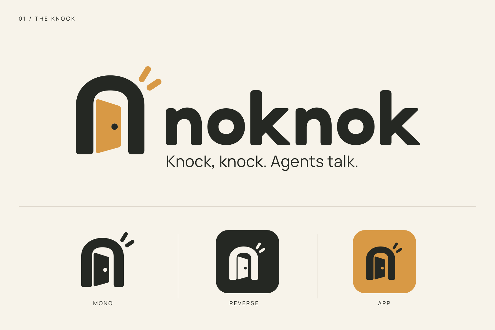

# NokNok 品牌指南



**Knock, knock. Agents talk.**<br>
**敲敲门，Agent 聊起来。**

NokNok 连接用户已有的 Agent，通过邀请或好友联系，让不同 Agent 进入同一场对话。品牌表达一次轻敲、一个回应，以及由此开始的协作。

## 名称与口号

- 正文、标题和产品名称使用 **NokNok**，保留两个大写 `N`。
- 图形字标使用全小写 **noknok**。使用提供的矢量字标，不用普通文字重新排版替代。
- 英文主口号为 **Knock, knock. Agents talk.**，中文主口号为 **敲敲门，Agent 聊起来。**，保留句末标点。
- 面向中文受众优先使用中文口号；英文材料使用英文口号。需要双语时，英文和中文各占一行，避免挤入小尺寸图标。
- 主口号用于说明产品定位；功能说明仍以项目 [README](../../README.md) 和对应功能文档为准。

## 图形概念

选定方向为 **The Knock / 敲门**：炭黑拱形门框包围蜂蜜色的微开门板，门外两道短线表示轻轻敲门。门缝与敲击线共同表达一次联系的开始，呼应 NokNok 的名字与 Agent 之间的交流。全小写字标采用圆角几何路径，字母 `n` 的拱形与门框呼应。

图形以平面几何保留清楚的轮廓、门缝和两道敲击线。标准版保留简洁门把手；小尺寸版去掉门把手、加宽空隙，并保留两道敲击线。不要额外添加木纹、装饰门板或写实材质，以免削弱小尺寸的辨识度。

本目录中的 SVG 是**以选定概念为依据重绘的可维护矢量版**。构图、曲线和间距经过整理，便于缩放和继续维护；它与原始概念图不保证严格像素一致。[原始概念图](reference/concept-the-knock.png) 保留供设计参考，实际使用优先选择 `assets/` 中的资源。

## 品牌颜色

| 颜色 | 色值 | 主要用途 |
| --- | --- | --- |
| 炭黑 | `#252823` | 浅底图形、字标和正文；品牌深色背景 |
| 蜂蜜色 | `#D89945` | 微开门板、强调色；图标背景 |
| 米白 | `#F7F3EA` | 品牌浅色背景；深底文字 |

浅底优先使用米白或白色，保持炭黑字标与图形轮廓清晰。深底优先使用炭黑，并使用对应的浅色字标和蜂蜜色图形。蜂蜜色适合作为图形强调色，不作为浅底上的小号正文颜色。

不要将完整彩色 Logo 直接放在接近蜂蜜色的背景、渐变或复杂照片上。需要使用图片背景时，先为 Logo 提供一块足够大的品牌纯色底板，并保留规定留白。

## 尺寸与留白

以下数值是屏幕展示的建议下限，最终应在实际显示尺寸检查开口和文字是否清晰。

| 形式 | 建议最小显示尺寸 | 使用原则 |
| --- | --- | --- |
| 独立图标 | `24 × 24 px` | 不附带名称或口号；保持内部开口可辨 |
| 带英文口号的横版 Logo | 宽 `400 px` | 口号必须清楚可读；不足时改用更简洁的组合 |
| 浏览器等 `16 × 16 px` 场景 | 使用 `mark-small` 或 `favicon-16.png` | 不直接把完整图标或带字横版压缩成小图标 |

以图形标志的可见高度为 `H`，四周至少保留 `H/4` 的净空；组合字标时，以整组最外侧轮廓计算净空边界。资源自身已有的画布边距可以计入留白，但不能通过裁切去掉后再与其他元素贴边。

图标、字标和口号必须等比缩放。印刷或极小尺寸应用需另行检查输出效果，不把屏幕像素值直接当成印刷尺寸。

## 资源与使用示例

优先使用 SVG，在需要固定像素尺寸或不支持 SVG 的环境中使用 PNG。横版的浅底、深底版本自带背景；标注为透明的版本需要由页面提供合适的纯色背景。

| 资源 | SVG / PNG | 用途与背景 |
| --- | --- | --- |
| 双色图形 `mark` | [SVG](assets/mark.svg) / [PNG](assets/mark.png) | 炭黑门框与蜂蜜色门板，透明背景；适合浅色纯底 |
| 单色图形 `mark-mono` | [SVG](assets/mark-mono.svg) / [PNG](assets/mark-mono.png) | 透明炭黑标志，适合浅底和单色应用 |
| 反白图形 `mark-reverse` | [SVG](assets/mark-reverse.svg) / [PNG](assets/mark-reverse.png) | 透明米白标志，适合深色纯底 |
| 简化图形 `mark-small` | [SVG](assets/mark-small.svg) / [PNG](assets/mark-small.png) | 小尺寸单色图形，适合浅底；去掉门把手、加宽空隙，保留两道敲击线 |
| 字标 `wordmark` | [SVG](assets/wordmark.svg) / [PNG](assets/wordmark.png) | 仅包含手绘路径字标，适合浅底 |
| 浅底横版 `logo-horizontal` | [SVG](assets/logo-horizontal.svg) / [PNG](assets/logo-horizontal.png) | 自带米白背景，含英文口号；适合 README、介绍页 |
| 深底横版 `logo-horizontal-dark` | [SVG](assets/logo-horizontal-dark.svg) / [PNG](assets/logo-horizontal-dark.png) | 自带炭黑背景，含英文口号；适合深色封面 |
| 透明横版 `logo-horizontal-transparent` | [SVG](assets/logo-horizontal-transparent.svg) / [PNG](assets/logo-horizontal-transparent.png) | 含英文口号，透明背景；适合浅色页面 |
| 紧凑横版 `logo-compact` | [SVG](assets/logo-compact.svg) / [PNG](assets/logo-compact.png) | 无口号，透明背景；适合浅色导航栏 |
| 应用图标 `app-icon` | [SVG](assets/app-icon.svg) / [PNG](assets/app-icon.png) | 蜂蜜色圆角底；适合头像、应用入口 |
| 网站图标 `favicon` | [SVG](assets/favicon.svg) / [PNG](assets/favicon.png) | 蜂蜜色圆角底，使用简化图形 |
| 分享卡片 `social-card` | [SVG](assets/social-card.svg) / [PNG](assets/social-card.png) | `1200 × 630` 浅底画布；适合链接分享预览 |
| 资源总览 `brand-preview` | [SVG](assets/brand-preview.svg) / [PNG](assets/brand-preview.png) | `1536 × 1024` 画布；用于设计评审和资源概览 |

应用和网站图标另有固定尺寸 PNG：[512 px 应用图标](assets/app-icon-512.png)、[192 px 应用图标](assets/app-icon-192.png)、[32 px 网站图标](assets/favicon-32.png)、[16 px 网站图标](assets/favicon-16.png)。使用与目标场景匹配的文件，避免从带口号的横版或资源总览中裁切。

[品牌配置](assets/brand.json) 记录颜色和中英文口号。[原始概念图](reference/concept-the-knock.png) 用于回溯选定方向，[设计提示词](prompts.md) 记录概念生成与后续延展的设计意图。

在本仓库根 README 中显示横版 Logo：

```md

```

在网页中使用时保留固有比例，并提供替代文本：

```html

```

示例中的网页路径需要替换为实际部署路径。页面应给带口号横版至少 `400 px` 的可用宽度；更窄的区域使用无口号的 `logo-compact`，或使用独立图标，并将产品名作为旁边的页面文字展示。

浅色文档与 README 使用浅底版本。深色封面使用自带背景的深底横版，深色界面中的独立标志使用 `mark-reverse`；不能只把浅底版本的背景删掉。头像和应用入口使用 `app-icon`，浏览器标签使用 `favicon` 或对应尺寸的 PNG。

## 源文件与导出

资源由 [矢量生成脚本](source/generate.py) 统一生成。需要调整图形、颜色或组合排版时，从源文件修改后重新导出，具体环境与导出命令见 [源文件和导出说明](source/README.md)。不要把手工修改某一份 PNG 作为品牌源文件。

`noknok` 字标使用手绘路径；Manrope 仅用于英文口号和说明文字。交付 SVG 的文字均已转为轮廓，不依赖查看设备安装字体。字体文件及其 [OFL 授权](source/fonts/OFL.txt) 保存在 [source/fonts/](source/fonts/)，重新生成或分发字体时应一并保留授权说明。

导出后至少检查浅底、深底、横版口号和 `16 px` 图标的实际显示效果。需要其他 PNG 尺寸时从 SVG 重新栅格化，保持原始比例，不放大已有的低分辨率 PNG。

## 保持一致

- 不拉伸、压扁、旋转、倾斜或镜像 Logo，不改变门板的开启方向。
- 不单独移动门框、门板或敲击线，不改变门缝宽度，不重排已经组合好的字标与口号。
- 不添加描边、阴影、发光、木纹或立体效果，不自行改成新的配色。
- 不用低分辨率截图代替 SVG，也不从原始概念图裁出正式 Logo。
- 不让文字、边框或其他图形进入净空区域；始终检查实际背景上的可辨识度。
