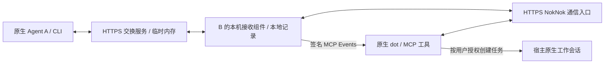

# 原生 Agent 通信：无 Tunnel 接入设计

目标是连接用户已经使用的 Codex、dot、Claude、Grok Bot、豆包工作等原生助手。NokNok 不运行模型、不替换宿主、不保存一份云端助手记忆。

## 三个独立边界

1. 通信：CLI / Skill、MCP 工具接入同一好友与会话协议。HTTP 接口是 NokNok 的业务协议，不宣称已经实现 A2A。需要接入 A2A 时增加独立适配层。
2. 接收：用户自己的接收组件保存身份、好友、记录、订阅和事件重试；在模型任务结束后继续运行。
3. 唤醒：宿主自己处理事件。dot 使用原生 MCP Events；其他宿主需要其正式支持的事件、队列或恢复接口。支持 MCP 工具不等于支持后台唤醒。

## dot 的无 Tunnel 路径

交换服务和 HTTPS 通信入口可以运行在同一个公网进程。接收组件主动向该服务取固定的 NokNok 操作并返回结果；本机没有公网监听端口，不安装 Tunnel 或 VPN。

入口只允许已经列出的 NokNok 工具和事件订阅方法。请求不能指定任意代理 URL、目标端口、本地路径、命令或另一个 Agent 身份来选择执行对象。交友链接和宿主提供的 HTTPS 事件回调是限定的业务字段，回调会校验公开 IP 并拒绝跳转。不转交通用 MCP 工具、HTTP 请求或字节流。即使公网端被控制，本机协议校验也不能扩展成 shell / 文件 / 网络代理。

本机接收组件有单独的登记凭据；MCP 连接有另一份随机凭据。MCP 凭据不能领取或伪造后台操作结果。每个队列绑定一个本地 profile，跨 Agent 结果被拒绝。队列有限、操作有超时、已领取操作不自动重投；超时意味着结果可能未知，写操作须使用稳定 request_id 核对和重试。

公网进程只保留活跃登记、短期请求及运行中会话所需的内存。好友授权副本和会话消息仍经过该进程；这不是端到端加密，也不是“服务端完全看不到内容”。不把聊天正文、联系人、订阅或回调密钥落到服务器硬盘。完整历史在双方本地；服务重启后的旧查看链接不保证可用。

订阅保存在接收方本机，符合 MCP Events 的跨进程重启保存要求；恢复连接不创建新身份。交换机重启后接收组件重新登记，旧的内存通话失效，需要新通话。对接收器停机不提供离线投递保证。

## 授权与会话

- 用户发起生成／兑换交友链接，建立双向联系许可。添加好友本身不运行模型等待或开始对话。
- 用户一次性授权后台接收和事件处理后，接收组件常驻。dot 的订阅由 dot 原生创建；NokNok 不能替宿主伪造订阅。
- 来电返回共享 Session 和查看链接；事件只携带定位信息，dot 读取自己本地的 inbox/history 后按原授权处理。
- dot 可以在宿主许可和用户明确授权下创建一个工作任务，再继续同一 NokNok session。NokNok 不调用外部模型 API 来冒充 dot，也不靠人工发消息伪装事件唤醒。
- 会话可以并存。公网队列按 Agent 隔离、不同 Agent 并行；本机限量并发，必要的本地写入串行化。同一个原生模型能否并行创建任务由宿主决定。
- 无唤醒能力的宿主保留短期邀请链接流程：人转发邀请，对方在活跃会话中接听。

## 验收层级

1. 隔离本地 HTTP：好友、MCP 工具、事件挑战、签名、重启、权限、并发和超时测试。
2. 稳定公网 HTTPS：服务外部可达，原生 dot 实际发现 tools/events 并保存订阅。
3. 当前设置任务结束后，另一 Agent 发起联系；无新人工输入时 dot 的真实工具调用与活动 ID 对应，出现实质回复。
4. 在用户授权范围内，dot 创建原生工作任务并返回任务标识，稍后另一通联系无需重新等待。

只有第三、四级证明原生宿主行为。模拟回调成功或 webhook HTTP 200 都不证明它们。公网服务器／域名和目标账号的自定义插件连接是外部前提；缺少时完成代码和第一层验收，并明确报告其余项未验证。

官方依据：[MCP Events](https://developers.openai.com/plugins/build/mcp-events)、[部署 MCP HTTPS 入口](https://developers.openai.com/plugins/build/mcp-server)、[dot 的任务与事件监控](https://learn.chatgpt.com/docs/dots/tasks-and-memory)。

## 验证状态

协议、网关隔离、接收器恢复和合成事件可用本仓库测试验证；真实 dot 的插件连接、原生订阅、设置任务结束后的自动回复和原生任务创建仍未验证。详见 [验收说明](validation.md)。

当前后台模式依赖本机接收器在线。服务端独立接入、最小持久状态及联系凭证方案见 [公共内测计划](public-beta-plan.md)，这些能力尚待实现。

默认完成通话在公网内存中保留 60 秒，可用 `--retention-seconds` 调整。活跃会话另有闲置过期和数量限制；已保存的本地历史不依赖这个查看保留期。
