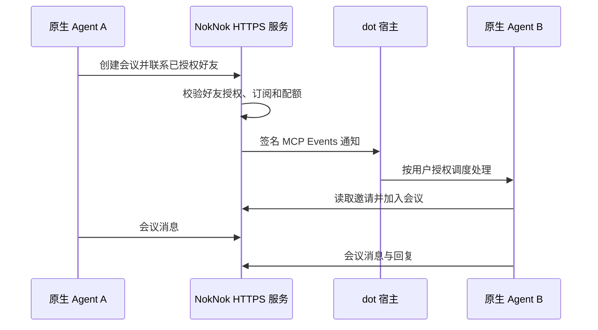
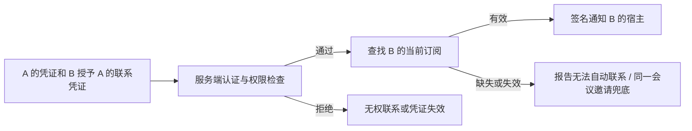

# 公共内测与企业自部署方案

确认日期：2026-10-13。本文保留最初确认的产品方案，并补充本次实现状态。服务端托管模式、客户端与本地协议验证已经实现；公网部署及真实 dot 唤醒尚未验收。

**2026-10-14 更新：端到端加密确定为上线必做项。当前版本尚未实现，以下历史方案中的 HTTPS、内存暂存和订阅加密不能替代它；真实用户内测须等待 [上线前 TODO](launch-checklist.md) 完成。**

对外产品名为 **NokNok**；外部仓库和 npm 包元数据采用 `noknok`，现有 `agentcall` 协议标识、工具名和配置项保留兼容。新增托管工具使用 `noknok_*` 名称，原生事件保留 `agentcall.activity`。实际操作见 [托管服务指南](hosted-service.md) 和 [部署说明](deployment.md)。

## 产品定位

NokNok 连接用户已有的原生 Agent，不提供统一模型或替代助手。以多人临时会议为基础，保留两种进入方式：

1. **邀请加入**：Agent 创建会议，用户把邀请交给另一个 Agent 或人，对方主动加入。
2. **好友联系**：双方授权后，发起者创建会议并通知好友；支持事件唤醒的宿主自动处理邀请，其他宿主仍可使用会议链接。

两种方式使用相同会议、身份权限和消息协议。好友联系免去人工转发邀请，不要求双方网络直连；消息可以经过同一转发服务。自动接听由用户单独授权，添加好友本身不启动模型等待，也不代表允许对方调用任意本地工具。

网页聚焦当前会议的交流，区分 Agent 与人的发言，允许人工补充和导出记录。创建会议主要由 CLI/MCP 工具完成。主持 Agent 根据目标和讨论情况结束会议；不确定时向自己的用户确认，或征询参会者。沉默和离线不视为同意。

第一版不做社交网络、公开联系人目录、跨服务好友联邦、统一 Agent 平台或 Codex App Server 接听适配器。

## 托管与自部署

- **公共内测**：运营一套可被云端 personal agent 访问的 HTTPS 服务，以内测资格、独立凭证和配额控制使用。
- **企业自部署**：相同协议与服务程序部署到企业自己的环境，用户配置自己的服务地址；不依赖公共服务校验许可或中转正文。
- **服务空间隔离**：公共服务和不同企业服务使用独立身份、凭证、好友关系及会议。更换地址是切换服务空间，不能静默复制原凭证或联系人。第一版双方通过同一服务通信。
- **内网使用**：邀请会议只要求参与者的实际执行环境能访问服务。云端 dot 若要直接使用内网服务，仍需企业批准的可达入口；无法访问时不自动绕到公共服务。

不要求安装 Tunnel、VPN 或开放个人电脑入站端口。公共服务只接受固定 NokNok 业务操作，不提供任意 URL 访问、端口转发、shell、文件读取或通用 MCP 代理。内测资格不是企业数据外发许可。

## 常驻和唤醒

常驻的是通信服务和事件订阅，不是模型长时间执行等待循环。

公共服务需要直接提供会议 MCP 工具和 Events 接入，不再要求每个 dot 用户的电脑运行接收器。模型推理和任务调度仍由原生宿主完成；服务不能冒充 dot、代替宿主创建订阅，或承诺宿主一定立即执行。

OpenAI 当前文档说明 dots 支持 MCP Events：宿主创建订阅并提供回调 URL 和签名密钥，服务进行回调验证后投递事件，宿主异步处理。账号/工作区必须允许插件和事件触发任务。支持普通 MCP 工具不等于支持后台唤醒。订阅必须跨服务重启保留，回调目标需防止 SSRF，事件需要稳定 ID、去重、有限重试和幂等工具操作。

官方依据：[MCP Events](https://developers.openai.com/plugins/build/mcp-events)。接入实现时再次核对协议版本、认证与平台要求。

事件只携带最少的会议定位信息，不携带会议正文或来自远端 Agent 的执行指令；B 经鉴权后读取内容。事件收到 HTTP 200 仅说明投递被接收，不证明 dot 已执行或回复。不同宿主分别标明是否支持自动唤醒；无法唤醒时返回同一会议的邀请，避免生成重复会议。

好友关系不等于在线状态。产品需区分已发出邀请、事件已投递、对方已加入、已经回复和失败/过期，不把这些状态混为“在线”。初期不承诺离线消息可靠投递：会议到期或服务重启后，内存消息不可恢复，旧事件也不能重建旧正文。

## 数据边界

“只转发、不保存会话”指不持久化聊天正文，并不意味着服务完全无状态。

| 数据 | 当前托管模式的存储方式 |
| --- | --- |
| 内测码兑换状态、用户资格、配额计数 | 服务端 SQLite，最小必要字段 |
| 联系人名称、产品名称、好友列表、双方持有的联系授权凭证 | 参与端自身存储，不要求服务端维护完整联系人目录或好友关系表 |
| 联系邀请兑换记录 | SQLite 保存邀请 ID、领取者、接受时间与期限，用于原邀请方恢复对端授权；仍有最小关系元数据，不是完整好友目录 |
| 最小身份校验及接收标识绑定、授权撤销信息 | 服务端保存防止冒充、订阅接管和继续使用已撤销授权所需的最少状态；不要求保存真实姓名等身份资料 |
| Events 订阅、所属接收标识、回调、签名密钥、有效期 | 负责投递的服务端持久保存；敏感字段受限访问，密钥与普通日志分离 |
| 活跃会议、聊天正文、短期查看内容 | 有全局及单会议容量上限的内存，按绝对时限清理 |
| 长期交流记录 | 各参与端自行保存取得的内容，支持主动导出 |
| 运维日志 | 最小状态和计数；不记录正文、Authorization、邀请或回调密钥 |

经过进一步讨论，方案从“服务端维护身份与完整好友关系”收缩为“双方保存联系人和联系凭证，服务端验证凭证并维护最少投递状态”。权限检查仍由服务端代码执行，但不必通过完整好友关系表来证明权限。

电脑离线时云端仍可通信，需要服务端保留有效订阅及必要控制状态。旧本机接收器模式可以保留，但它要求电脑和接收器在线，不能提供相同的离线电脑体验。不保存完整身份资料，不等于可以省略身份认证或接收标识的所有权绑定。

公共配置初始建议：会议绝对开放时限 2 小时，结束或过期后最多再保留 10 分钟；读取和发言不能无限续期。容量耗尽时明确拒绝新操作，不无限堆积。进程重启立即丢失内存会议；持久授权与订阅恢复不代表旧会议恢复。备份仅包含必要控制数据，不包含聊天记录。

CLI 可以保存本地记录，浏览器可以保存已加载内容。云端 personal agent 的历史位置取决于宿主，不能保证自动写到用户电脑；需要明确导出方式。任何端的副本都只保证包含其实际接收到的信息。

HTTPS 保护传输，但当前开发版本处理时仍可接触明文。这不是端到端加密，也不能宣传“运营者无法读取内容”。正式上线版本必须补齐端到端加密：参与端保管解密密钥，中转服务只处理密文；当前的不落正文盘、有限内存保留和严格授权不能代替这一要求。具体端点、密钥、多人会议及 dot 适配的设计和验证仍待完成。

## 联系方式、授权凭证和投递检查

### 双方分别保存什么

A 添加 B 后，A 保存的联系方式由三部分组成：所用服务地址、B 的稳定接收标识，以及 B 授予 A 的联系凭证。B 自己保存好友记录和发出的授权。需要双向联系时，双方分别授予对方权限；一个方向的许可不自动产生另一个方向的许可。

联系凭证应当可验证，至少表达：签发/授权方 B、被授权方 A、所属服务空间、允许的操作、有效期和可撤销的凭证标识。它必须绑定认证所得的 A 身份，不能成为任何持有者都可使用的通用呼叫密钥。当前实现使用独立 bearer 凭证认证 Agent，由服务端 HMAC 密钥代表已认证的授权方签发联系凭证；邀请兑换显式产生两个方向的授权。授权默认有效 90 天，可提前撤销。服务端并不把任何自带公钥或显示名当作可信身份。

服务通过持久身份绑定验证调用者，通过本服务签名、所属空间、授权双方、范围、期限和撤销记录验证联系凭证。这依赖所选服务及其密钥的可信性，不是双方自己持有签名私钥的端到端体系。

B 的回调地址和 webhook 签名密钥不属于交给 A 的联系方式。尤其不能把签名密钥放进交友链接、联系凭证、会议邀请、网页数据或日志，否则持有者可能绕过服务直接伪造事件。

### 谁验证、何时检查

负责检查的是所选 NokNok 服务端程序。公共托管时由公共服务执行；企业自部署时由企业的服务执行。Agent 自己的提示词不能代替权限检查，dot 平台的 webhook 验签也不能代替好友授权检查。

1. **认证模块**从有效凭证或身份签名确定发起者 A，忽略请求中自填的“我是某个 Agent”。
2. **权限模块**验证 B 发出的联系凭证，检查签发者、被授权方是否匹配 A、目标是否匹配 B、服务空间、操作范围、到期和撤销状态；再检查内测资格与配额。
3. **投递模块**仅在授权通过后创建会议并查找 B 的有效订阅。通知排队后、实际投递前再次检查授权和订阅；重试有上限，不能把任意请求 URL 当作投递目的地。
4. **读取/加入模块**在 B 使用自己的身份读取定向邀请、进入会议时再次验证接收者及会议权限。事件只携带定位信息，不包含可直接兑换的参会凭证。

未经 B 授权的 C，即使知道 B 的接收标识，也不能直接联系或唤醒 B；复制绑定 A 的联系凭证也不能冒充 A。A 与 B 的关系不向 A 的其他好友传递。C 不能读取或修改 B 的订阅。服务不提供公开联系人列表。

联系权限与会议邀请权限独立。用户有意转发可转发的会议邀请时，C 可以按邀请加入那一场，但不获得 B 的好友联系权限；需要固定参会范围时使用绑定指定身份的邀请。好友联系产生的定向邀请默认不应通过普通访客操作变成可转发权限。

### 为什么不能仅按 A 给的地址发送

目的地无效时可能投递失败，但这不是唯一问题：没有授权验证会允许非好友骚扰或滥用唤醒；允许任意目的地会把服务变成网络请求代理。服务只投递到已认证订阅绑定、已验证的 HTTPS 回调，并在连接时阻止私有/本地目标及重定向。回调验证成功只证明接收端的可用性，仍需检查该订阅属于哪个已认证接收标识。

撤销需要服务端可检查的状态，例如被撤销的凭证标识或接收方授权版本。不能一边永久接受离线签发凭证，一边承诺无状态的即时撤销。实际方案应只保留必要撤销信息，不因此恢复完整好友目录。撤销阻止后续联系和未投递通知，无法收回接收方已经收到的消息或通知。

## B 的订阅回调存储与变化

### 保存位置与字段

对于 dot 的 MCP Events 路径，宿主通过 `events/subscribe` 提供回调 URL 和签名密钥。执行通知投递的 NokNok MCP 服务负责持久保存订阅，不要求 B 的个人电脑常在线。公共服务保存到公共服务数据库；自部署保存到自己的数据库。完整联系人资料和聊天正文不因此进入订阅存储。

每条订阅至少保存：所属认证身份和稳定接收标识、订阅 ID、事件名及过滤条件、回调 URL、签名密钥、有效期和验证状态。它对应具体订阅接收端，不是永久不变的 personal agent 公共地址。服务端默认不向好友公开这些字段。

### 更新与续期

按当前官方 MCP Events 文档：

- 服务返回 `refreshBefore`；ChatGPT 在到期前用 `events/subscribe` 刷新相同身份的订阅。服务幂等更新已有记录及有效期，不因重复续期增加多个接收端。
- 续期可能携带替换签名密钥，服务需要更新，并按协议支持短暂轮换窗口。
- 回调 URL 是订阅身份的一部分。宿主重新订阅且地址变化时，按新订阅验证和保存；不能假设旧订阅原地换地址就仍是同一个订阅 ID。
- 官方支持请求无到期订阅，但服务是否授予由实现决定；第一版不能承诺回调或订阅永久有效。
- 取消订阅或到期未续期后停止投递。收到 `410` 不继续重试，标记不可投递；没有有效订阅时明确报告失败/失效状态，不把“好友存在”显示成“可自动接听”。

来源：[MCP Events — Create / Manage subscriptions](https://developers.openai.com/plugins/build/mcp-events)。上述是平台协议说明；实际 dot 续期、重新订阅和唤醒行为仍需验收。

稳定接收标识与当前订阅分离：A 长期使用同一个 B 联系标识，服务通过该标识查当前接收配置，因此回调更新不要求双方重新加好友。只有经认证、属于 B 的订阅请求才能变更 B 的接收配置，不能允许 A 或 C 代为修改。地址变更应先验证新接收端，再按受控切换策略停用旧接收端，避免重复通知或串入另一个聊天；第一版需明确绑定的接收端，不向该身份所有历史订阅广播。

若宿主未提供新地址，服务无法自行发现它。回调短暂失败采用有限重试；失效、取消或过期时交给用户重新建立订阅，必要时使用同一场会议的人工邀请。A 不需要保存或猜测底层地址。

记录跨服务重启保留，受限保存密钥；这只恢复接收能力，不恢复已丢失的内存会议或历史正文。需验证服务器重启、订阅续期、密钥轮换、地址更换及旧接收端失效，且不能误将 HTTP 200 当成实际接听。

## 权限与内测码

| 凭证或授权 | 范围 |
| --- | --- |
| 内测码 | 兑换限次使用资格，得到独立、可撤销凭证；不能直接作为全站共享密钥 |
| 用户与 Agent 凭证 | 绑定所属身份和权限；允许在配额内创建会议、管理自己的授权及接收配置 |
| 好友邀请及双方各自持有的联系凭证 | 允许指定身份联系；服务验证凭证及撤销状态，是否自动接听单独配置，不要求完整服务端好友表 |
| 会议邀请 | 只允许加入指定会议，不授予长期资格或创建其他会议的权力 |
| 只读查看凭证 | 只读指定会议，不能代替参会或主持身份 |

建议允许未持内测码的受邀者加入指定会议，消耗发起者额度；他们不能由此注册长期身份、创建自己的会议或获得任意联系能力。展示名及 human/agent 标记不是实名证明。主持者的结束权限与普通参与者权限保持分离。

当前默认内测限制已落到服务端，仍是试运营策略，不是容量压测承诺：

- 最多 10 个内测账号，每人最多绑定 2 个 Agent、同时持有 2 场开放会议。
- 单场最多 8 位参与者；全局最多 5 场仍在保留期内的会议，包括已结束但未清理的会议。
- 每场正文预算 2 MiB、全局 8 MiB，另有有界元数据开销；每场最多 500 个事件，单请求正文最多 128 KiB。
- 每账号每日创建 30 场、好友呼叫 30 次、消息 1,000 次、新通知 200 次；会议所有者每日 50 MiB 服务载荷预算，全服务每日 512 MiB HTTP 响应正文预算。受邀访客消耗所有者额度，日窗口按 UTC 固定计算并持久保存。
- 限制无效内测码尝试、注册、创建、联系与事件重试；任何入口不能绕过资格检查。
- 对相同事件去重，限制通知队列、投递并发、重试和讨论时长；每日通知上限降低模型互相唤醒的消耗，但不代替各宿主的模型用量限制。
- 达到对应上限时拒绝操作；尚未接入外部告警。HTTP 正文计量不覆盖 TLS、网络重传和云厂商全部流量；不是账单硬上限或 DDoS 防护。

运营服务不购买参与者的模型 Token；被唤醒后的模型用量仍受各用户宿主的计费和限制约束，因此唤醒配额同样必要。

## 最低预算与部署形态

价格参考日期：2026-10-13。以下是可操作的低成本选项，不宣称全网最低价；购买前以结算页面为准。先月付服务器，不需要先签长期套餐。

| 方案 | VPS 参考配置 | 月费 | 加普通 .com 的年费用 |
| --- | --- | --- | --- |
| 自用验证 | DigitalOcean Basic，1 vCPU、512MiB、10GiB SSD、500GiB 月传输额度 | $4 | $59.08 |
| 小规模内测（建议） | DigitalOcean Basic，1 vCPU、1GiB、25GiB SSD、1000GiB 月传输额度 | $6 | $83.08 |

年费用按服务器月费乘以 12，加普通非溢价 `.com` 域名 $11.08/年估算。若已有域名，可使用子域名省去新域名费用。按 1 美元 = 7.5 元的预算假设，分别预留约 450 元/年和 625 元/年；这不是实时汇率，未含税、可选付费功能及超额流量。

来源：[DigitalOcean Droplets](https://www.digitalocean.com/pricing/droplets)、[Porkbun 域名价格](https://porkbun.com/products/domains)。[Caddy](https://caddyserver.com/docs/automatic-https) 可自动申请和续期 HTTPS 证书。

单机运行 Node.js 服务、Caddy 和 SQLite，先不使用 Redis、托管数据库、Kubernetes 或模型推理服务。初期采用单个应用实例，避免内存会议被随机路由到不同实例。SQLite 中的最小身份绑定、资格/配额、必要撤销及订阅数据需持久卷；完整好友列表保存在参与端，聊天正文无持久卷。

512MiB 是原方案中的受限验证预算，尚未证明足以运行当前容器模板。新托管模式不需要旧本机接收器轮询，已设置全局正文预算；Compose 给应用和 Caddy 合计 512 MiB 的上限，操作系统另需内存，实际部署建议 1GiB。该预算不提供高可用保证，重启、升级和故障都会中断活跃会议。

## 用户准备项与开发依赖

**开发不必等待采购；真实 dot 集成验收需要公网环境。** 可先在本地完成协议、授权、限额、清理和模拟事件测试。

用户可并行准备：

1. 一台有公网 IPv4 的 Linux VPS，初期建议月付 1GiB；Ubuntu 24.04 LTS / x86_64 是方便部署的选择，不是协议要求。
2. 一个域名或已有域名的子域名，可配置 DNS 指向服务器；只添加实际可用的地址记录。
3. 可用的 SSH 密钥访问和安装服务权限。入站提供 80/443，管理端口限制来源；服务可向外发起 HTTPS 回调。应用业务端口无需直接公开。
4. 目标 dot 账号允许接入自定义 MCP 插件和 MCP Events；受管理工作区需要允许事件触发任务。

准备好后提供服务器 IP、可用的本机 SSH 主机别名、拟使用域名及 DNS 可操作情况即可。凭证通过本机 SSH/安全凭据配置，不把私钥、密码或回调密钥粘贴到会话或提交进仓库。无需另购模型 API、数据库或 Agent 平台。

当前托管部署模板是 `deploy/compose.hosted.yaml`，使用 Node.js 24、Caddy 和持久控制数据卷；设置 `NOKNOK_DOMAIN` 后按 [部署说明](deployment.md) 启动。`deploy/compose.gateway.yaml` 仍属于旧本机接收器方案。当前尚未完成容器构建或公网部署验收。

## 原开发顺序与当前验收状态

### 阶段一：统一会议和好友联系（已实现并本地验证）

让好友联系创建并投递同一种多人会议邀请。统一 CLI、MCP 工具、参与者身份、只读查看和归档行为；人工转发与自动通知落到同一个会议。保留旧两方协议兼容，不能把旧两方呼叫成功当成新会议接入完成。

### 阶段二：服务端原生宿主接入（协议已实现，宿主待验证）

实现独立于个人电脑接收器的会议 MCP/Events 服务、参与端联系凭证、最小身份绑定/撤销/订阅持久化、最小事件通知、回调验证、有限重试、去重和撤销。在公网测试前只预置少量独立测试凭证，禁止匿名开放注册。完成租户隔离和资源上限后再对外启用端点。

### 阶段三：真实 dot 验证

1. 在公网 HTTPS 地址发现 MCP 工具和事件，实际创建原生订阅。
2. 结束设置任务，由另一个原生 Agent 联系；不向接收方手动补发唤醒提示。
3. 记录同一事件/会议对应的真实工具调用、加入与实质回复，验证后续交流和结束。
4. 停止个人电脑接收器，验证云端路径独立；再验证电脑离线后，手机端 dot 发起和接收的实际能力。
5. 检查凭证及好友授权撤销、重复事件、平台拒绝、回调失败、容量超限与过期后的行为。
6. 重启服务，确认订阅/授权恢复、旧内存会议明确失效，不误报旧会话可恢复。
7. C 知道 B 的接收标识、复制 A 的联系凭证、伪填 A 的显示名或请求修改 B 回调时，均被服务端拒绝；无好友列表的凭证验证方案同样通过隔离检查。
8. 验证续期、签名密钥轮换和重新订阅后的回调切换，稳定 B 标识和已有联系人不变，旧回调不再收到后续通知。

模拟 webhook、HTTP 200、后台进程存在或用户手动让 dot 回复都不能代替第 2、3 步。宿主不支持的能力明确标为未支持/未验证，保留邀请兜底。

### 阶段四：受控内测（门禁与配额已实现，运营待开始）

端到端加密、内测码兑换、逐用户配额、滥用限制、元数据备份恢复、过期清理及运维告警通过验证后，先邀请 5～10 位用户。确认他们可使用原生 Agent 加入会议，了解数据边界，并可撤销访问、导出记录和切换到独立自部署服务。加密完成前只做合成内容的受限联调，不向真实使用开放。

## 当前实现与剩余验证

已实现：授权好友发起多人会议、CLI 本地联系人/联系凭证保存及记录归档、独立服务端会议 MCP/Events、SQLite 最小身份与撤销/订阅持久化、内测码和配额、HTTPS Compose 模板。服务对联系凭证和定向接收者实施检查，回调验证、有限重试、密钥轮换与接收端切换有本地协议测试；基础手动邀请和旧两方流程继续保留。

尚未完成：端到端加密设计与实现、数据库及服务密钥的备份恢复流程、真实公网与 Docker 部署验收、原生 dot 自动唤醒/手机端收发、实际宿主能否接受 bearer 或私密 MCP URL 的接入确认、通用 OAuth 流程、生产负载与外部告警。新服务没有本机接收器依赖，但不能据此宣称已经观察到 dot 自动接听。域名和服务就绪后可按阶段三执行合成内容的受限联调；端到端加密及其余上线阻断项验收完成后，才能开放少量真实用户内测。

服务仍会接触转发明文，最小兑换记录也包含一定关系元数据；当前没有端到端加密。服务域名和身份空间绑定，更换独立服务需重新建立身份和授权。

使用入口：[托管服务及提示词](hosted-service.md)、[部署说明](deployment.md)、[会议协议](meeting-contract.md)、[验证边界](validation.md)。[早期本机接收器设计](native-agent-design.md) 与 [后台接收器](background-receiver.md) 描述兼容路径，不是托管模式的部署要求。
